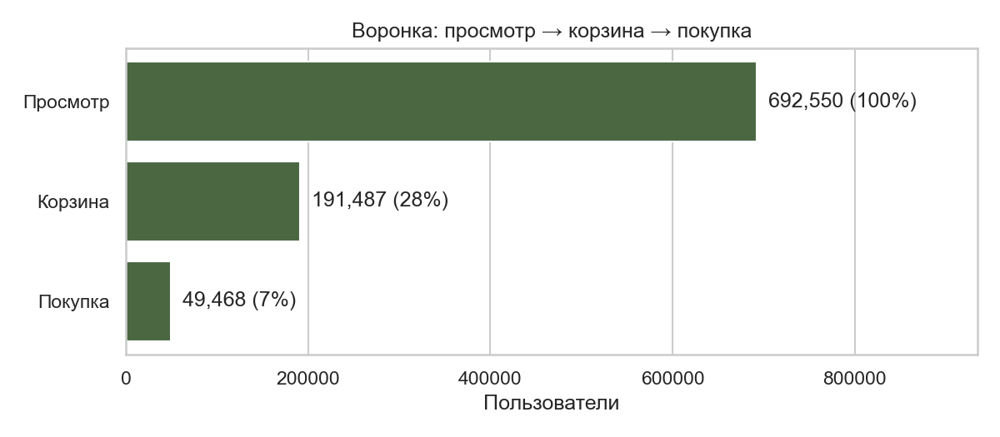
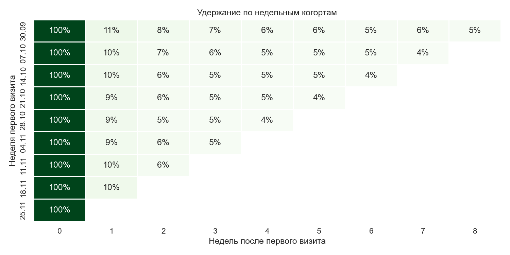
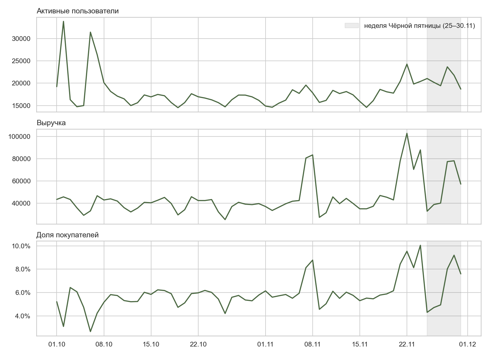

# Где интернет-магазин теряет покупателей
### Воронка, когорты, Чёрная пятница и дизайн A/B-теста на 9 млн событий

**Вопрос.** На каком шаге магазин косметики теряет больше всего покупателей, возвращаются ли они после первого визита и как проверить гипотезу о росте конверсии.

**Стек:** PostgreSQL · SQL (CTE, агрегаты с FILTER, оконные функции, JOIN, даты) · Python (pandas, matplotlib, seaborn, statsmodels, scipy)

## Главные выводы

1. **Узкое место — шаг «[корзина → покупка]»:** из предыдущего шага проходит [X]% пользователей. [одно предложение, что это значит]
2. **Удержание:** на следующей неделе возвращается [X]% новых пользователей (медиана по когортам), к неделе 4 — около [Y]%.
3. **Чёрная пятница:** конверсия «корзина → покупка» [X]% против [Y]% в обычные дни ноября, разница [+Z] п.п. (95% ДИ [..; ..], p [< 0,001]). Данные наблюдательные: это связь, а не доказанный эффект скидок.
4. **Цена:** конверсия корзины по ценовым квартилям [отличается / почти не отличается] ([диапазон]%, χ², p = [..]).
5. **A/B-тест** гипотезы «[показывать в корзине порог бесплатной доставки]»: чтобы заметить рост на 10%, нужно [N] сессий в группе — около [D] недель трафика.





## Рекомендации

| Наблюдение | Гипотеза | Что сделать | Как проверить |
|---|---|---|---|
| [узкое место воронки, цифра] | [например, неожиданная стоимость доставки] | [порог бесплатной доставки в корзине] | A/B-тест: [N] сессий в группе, [D] недель |
| [удержание на неделе 1, цифра] | [нет повода вернуться после первой покупки] | [письмо через 7 дней с подборкой к купленному] | сравнить когорты; лучше — A/B-тест |
| [Чёрная пятница, цифра] | [срочность важнее размера скидки] | [короткие акции с таймером в обычные дни] | A/B-тест, потому что сравнение периодов не доказывает причину |

## Данные

[eCommerce Events History in Cosmetics Shop](https://www.kaggle.com/datasets/mkechinov/ecommerce-events-history-in-cosmetics-shop) — обезличенные события интернет-магазина косметики (данные REES46), октябрь–ноябрь 2019: [N] млн событий, [N] тыс. пользователей.

**Качество данных:** [N] полных дублей и [N] строк с ценой ≤ 0 удалены ([X]% строк). У [X]% событий не указан бренд — строки оставлены, бренд в анализе не используется.

## Методы

- **Воронка** по пользователям, строгая: шаг включает все предыдущие.
- **Когорты** по неделе первого визита, удержание — доля когорты, активная через N недель.
- **Z-тест для двух долей** и доверительный интервал разницы (конверсия «корзина → покупка» по сессиям).
- **Хи-квадрат** для сравнения конверсии корзины по ценовым квартилям (`ntile`).
- **Размер выборки и длительность A/B-теста** для MDE 5 / 10 / 15%, α = 0,05, мощность 0,8.

## Ограничения

- Данные начинаются 1 октября: «первый визит» в октябре не всегда означает нового клиента.
- Конверсия по сессиям не учитывает покупки, сделанные в другой сессии.
- «Заказ» приближён сессией с покупкой: номера заказа в данных нет.
- Сравнение Чёрной пятницы с обычными днями — наблюдательное, без контрольной группы.

## Как воспроизвести

1. Установить PostgreSQL, создать базу `cosmetics`.
2. Скачать `2019-Oct.csv` и `2019-Nov.csv` с Kaggle в папку `data/`.
3. `pip install -r requirements.txt`, открыть `notebooks/analysis.ipynb` и запустить все ячейки.

## Структура

```
sql/        01–03 загрузка, проверки, очистка · 04–08 аналитические запросы
notebooks/  analysis.ipynb — анализ, статистика, графики
images/     графики для README
```

---
Автор: [Имя Фамилия] · [ссылка на сайт] · [Telegram]
