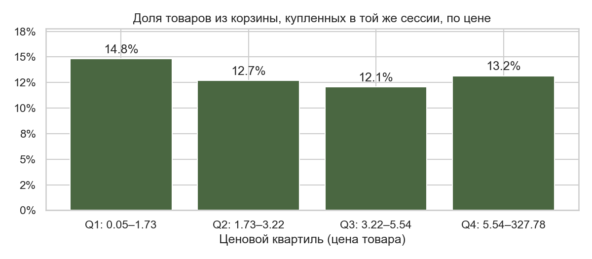

# Где интернет-магазин теряет покупателей
### Воронка, удержание, промо-дни и дизайн A/B-теста на 8,7 млн событий

Я взял реальные логи интернет-магазина косметики за октябрь и ноябрь 2019 года и хотел понять, на каком шаге магазин теряет людей и что можно с этим сделать. Заодно мне было интересно пройти весь путь аналитика самому: от сырых данных до рекомендаций для маркетинга.

| 7,1% | 74% | ~10% | 1 неделя |
|:---:|:---:|:---:|:---:|
| просмотревших товар доходят до покупки | добавивших в корзину так и не покупают | новых пользователей возвращаются через неделю | нужно A/B-тесту, чтобы заметить рост конверсии корзины на 10% |

Если коротко: больше всего людей магазин теряет на корзине, когда товар уже выбран. Чёрная пятница конверсию не подняла, зато средний чек снизился. Самые сильные продажи были в другие дни ноября. Первым делом я бы проверил напоминания о брошенной корзине, такой тест можно провести за неделю.

**Стек:** PostgreSQL, SQL, Python (pandas, matplotlib, seaborn, statsmodels, scipy)

---

## Что это даёт бизнесу

- **Понятно, с чего начинать.** Из корзины уходят люди, которые уже почти купили. Вернуть их обычно дешевле, чем привлечь новых.
- **Есть оценка эффекта.** Если напоминания поднимут конверсию корзины на 10% (с 13,8% до 15,2%), магазин получит около 95 дополнительных заказов в день. При текущем трафике и среднем чеке это примерно +8% к дневной выручке. Это оценка на случай, если гипотеза подтвердится, и проверять её нужно тестом.
- **Есть план проверки.** Известно, сколько людей нужно в тест и сколько он продлится, поэтому решение можно принять через неделю, а не наугад.
- **Видно, где могут уходить деньги.** Скидки Чёрной пятницы снизили средний чек, но конверсию не подняли. Часть рекламного трафика приводит людей, которые ничего не покупают.

---

## Как делался проект

1. **Данные.** Открытый датасет с Kaggle: 8,7 млн событий (просмотр, добавление в корзину, удаление из корзины, покупка) от 713 тыс. пользователей.
2. **Загрузка и проверка.** Загрузил данные в PostgreSQL на своём компьютере и проверил их на дубли, пропуски и странные цены.
3. **SQL.** Посчитал воронку, когорты, метрики по дням и конверсию по ценовым группам.
4. **Python.** Проверил гипотезы статистическими тестами, рассчитал A/B-тест и построил графики.
5. **Маркетинг.** Сформулировал выводы и рекомендации.

В работе я использовал Claude как ассистента: он помог подобрать датасет и разобраться с ошибками. Вопросы исследования, запуск анализа, проверка результатов и выводы мои.

---

## 1. SQL: подготовка данных и расчёты

Вся тяжёлая работа с 8,7 млн строк идёт в PostgreSQL. В Python попадают уже небольшие итоговые таблицы.

**Что сделано:**
- **Проверка качества.** Нашёл 459 848 полных дублей (5,3% строк) и 17 728 строк с ценой ноль или меньше и удалил их. У 41,7% событий не указан бренд. Эти строки я оставил, потому что бренд в анализе не нужен.
- **Очистка.** Сделал чистую таблицу без дублей и неверных цен, перевёл даты из текста в формат даты и добавил индексы, чтобы запросы работали быстрее.
- **Воронка** «просмотр, корзина, покупка» по пользователям. Воронка строгая: на следующий шаг попадает только тот, кто прошёл предыдущий.
- **Недельные когорты.** Сколько новых пользователей возвращается через одну, две, три и больше недель.
- **Метрики по дням:** активные пользователи, выручка, средний чек, доля покупателей.
- **Ценовые группы.** Товары в корзине разделил на 4 равные группы по цене с помощью оконной функции `ntile`.

**Что использовал:** CTE (`WITH`), агрегаты с `FILTER`, `bool_or`, `JOIN`, `CASE`, `date_trunc`, оконные функции.

Скрипты лежат в папке [`sql/`](sql) и пронумерованы в порядке запуска (01-08).

---

## 2. Python: статистика и графики

**Что сделано:**
- **Z-тест для двух долей.** Проверил, отличается ли конверсия корзины в неделю Чёрной пятницы от обычных дней. Кроме p-value посчитал доверительный интервал разницы: он показывает, насколько разница большая, а не только есть ли она.
- **Хи-квадрат и V Крамера.** Проверил, зависит ли конверсия корзины от цены товара. V Крамера нужен потому, что на 2 млн наблюдений значимой получается почти любая разница, и важно понять, велика ли она на самом деле.
- **Расчёт A/B-теста.** Сколько сессий нужно в каждой группе и сколько дней займёт тест, чтобы заметить рост на 5, 10 или 15%.
- **Графики:** воронка, тепловая карта удержания, динамика по дням, конверсия по цене.

Весь анализ лежит в блокноте [`notebooks/analysis.ipynb`](notebooks/analysis.ipynb), результаты ячеек сохранены.


---

## 3. Маркетинг: выводы и рекомендации

### Что я нашёл

**Больше всего людей уходит из корзины.** Из 692 тыс. человек, которые смотрели товары, в корзину что-то добавили 27,6%, а купили из них 25,8%. Получается, 74% людей, которые уже выбрали товар, ушли без покупки. Кроме того, 66% добавлений в корзину потом отменялись. Если считать по пользователям за два месяца, из корзины покупает 25,8%, а внутри одной сессии всего 13,8%. Похоже, многие откладывают покупку и возвращаются позже, так что напоминание о корзине может им помочь.

**Люди редко возвращаются.** Через неделю на сайт приходит около 10% новых пользователей, к четвёртой неделе около 5%. Дальше цифра почти не меняется: у магазина есть небольшое ядро постоянных покупателей, а большинство уходит после первого визита.

**Чёрная пятница не подняла конверсию.** В неделю распродажи конверсия корзины была 14,1%, в обычные дни ноября 13,8%. Разница в 0,3 п.п. статистически не значима (95% ДИ от -0,1 до +0,6 п.п., p = 0,117). Выручка в день выросла на 8%, но средний чек упал на 6,5%.

**Самые сильные продажи были в другие дни.** Максимальная выручка была 22 ноября (102,9 тыс. при обычных 35-45 тыс.), высокие дни также 24 ноября и 7-8 ноября. После каждого такого пика продажи проседали. Данных об акциях в датасете нет, поэтому могу только предположить, что это собственные распродажи магазина, которые сдвигали покупки по времени, но не добавляли новых.

**Трафик без покупок.** 2 и 6 октября активных пользователей было вдвое больше обычного (до 34 тыс.), но доля покупателей упала до 3%. Похоже на рекламную кампанию, которая привела много посетителей и почти не принесла покупок.

**Цена почти не влияет.** Самые дешёвые товары покупают из корзины немного чаще (14,8% против 12-13% у остальных). Разница значима, но очень маленькая (V Крамера = 0,03), так что причина брошенных корзин скорее не в цене.




### Что я бы предложил

| Наблюдение | Возможная причина | Что сделать | Как проверить |
|---|---|---|---|
| 74% бросают корзину, многие покупают позже, в другой сессии | откладывают покупку, отвлекаются, сравнивают цены | напоминание о брошенной корзине: письмо или пуш через несколько часов | A/B-тест: 10 202 сессии в группе, 1 неделя |
| Через неделю возвращается только около 10% новых пользователей | после первого визита нет повода вернуться | письмо через 3-7 дней с подборкой к просмотренным или купленным товарам | удержание на первой неделе по когортам, A/B-тест на новых пользователях |
| Всплески трафика без роста покупок | реклама приводит нецелевую аудиторию | оценивать рекламные каналы по доле покупателей и выручке на посетителя, а не только по числу визитов | сравнить каналы по UTM-меткам (в этих данных их нет) |
| В Чёрную пятницу конверсия не выросла и чек снизился, после пиков продажи проседают | скидки сдвигают спрос по времени и уменьшают средний чек | ввести минимальную сумму заказа для скидки, оценивать акции по марже, а не по выручке за день | A/B-тест порога скидки: средний чек и конверсия корзины |

Причины в таблице это мои гипотезы. Данные показывают, что происходит, но не объясняют почему, поэтому для каждой рекомендации указано, как её проверить.

### Как проверить главную гипотезу: дизайн A/B-теста

- **Гипотеза:** напоминание о брошенной корзине повышает конверсию из корзины в покупку.
- **Главная метрика:** доля сессий с корзиной, которые закончились покупкой (сейчас 13,8%).
- **Барьерные метрики**, чтобы рост конверсии не оказался за счёт чего-то другого: средний чек и доля удалений из корзины.
- **Сколько нужно людей и времени** (α = 0,05, мощность 0,8, около 6 900 сессий с корзиной в день):

| Хотим заметить рост | Цель | Сессий в группе | Длительность |
|---|---|---|---|
| на 5% | 13,8% → 14,5% | 40 011 | 12 дней, то есть 2 недели |
| на 10% | 13,8% → 15,2% | 10 202 | 3 дня, то есть 1 неделя |
| на 15% | 13,8% → 15,9% | 4 621 | 2 дня, то есть 1 неделя |

- **Правила проведения.** Длительность округляется до целых недель, потому что в будни и выходные люди покупают по-разному. В группы делятся пользователи, а не сессии. Тест не останавливают раньше срока, даже если результат кажется очевидным. Перед выводами нужно проверить, что группы получились примерно одинаковыми по размеру.

---

## Ограничения

- Данные начинаются 1 октября, поэтому первый визит в октябре не всегда означает нового клиента. Из-за этого удержание ранних когорт может быть немного завышено.
- Конверсия по сессиям не учитывает покупки, сделанные в другой сессии.
- Номера заказа в данных нет, поэтому заказом я считаю сессию, в которой была покупка.
- Часть удалённых дублей может быть повторными единицами одного товара, поэтому выручка может быть немного занижена.
- Сравнение Чёрной пятницы с обычными днями не эксперимент: оно показывает связь, но не причину. К тому же в обычные дни попали ноябрьские пики, и это размывает сравнение. Неделю распродажи я выбрал заранее по календарю и не стал менять её после того, как посмотрел на данные, чтобы не подгонять результат.

## Данные

[eCommerce Events History in Cosmetics Shop](https://www.kaggle.com/datasets/mkechinov/ecommerce-events-history-in-cosmetics-shop): обезличенные события интернет-магазина косметики (данные REES46), октябрь и ноябрь 2019 года. Валюта сумм в датасете не указана.

## Как воспроизвести

1. Установить PostgreSQL и создать базу `cosmetics`.
2. Скачать `2019-Oct.csv` и `2019-Nov.csv` с Kaggle в папку `data/`.
3. Выполнить `pip install -r requirements.txt`, открыть `notebooks/analysis.ipynb` и запустить все ячейки.

```
sql/        01-03 загрузка, проверки, очистка; 04-08 аналитические запросы
notebooks/  analysis.ipynb: анализ, статистика, графики
images/     графики для README
```

---
Автор: Михайлов Антон · Telegram: [@Lloswy](https://t.me/Lloswy)
